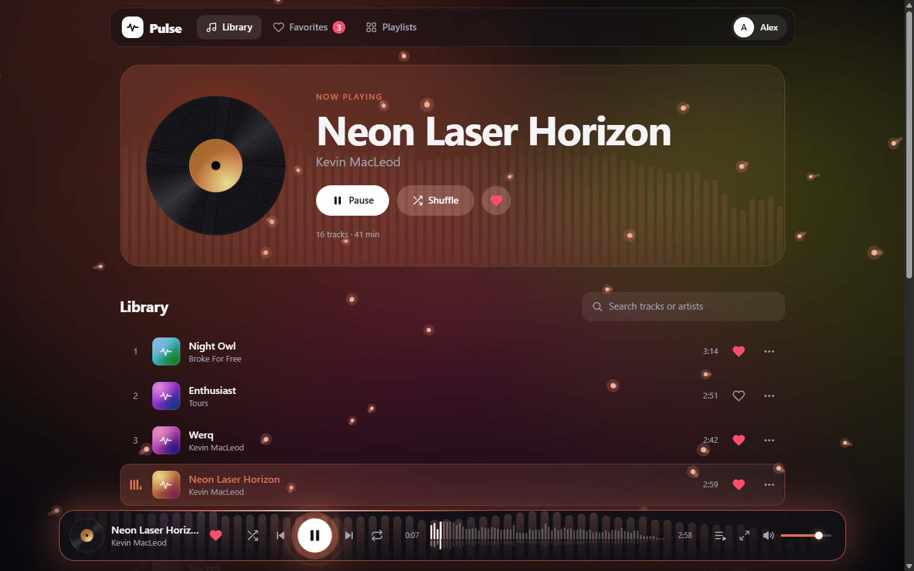
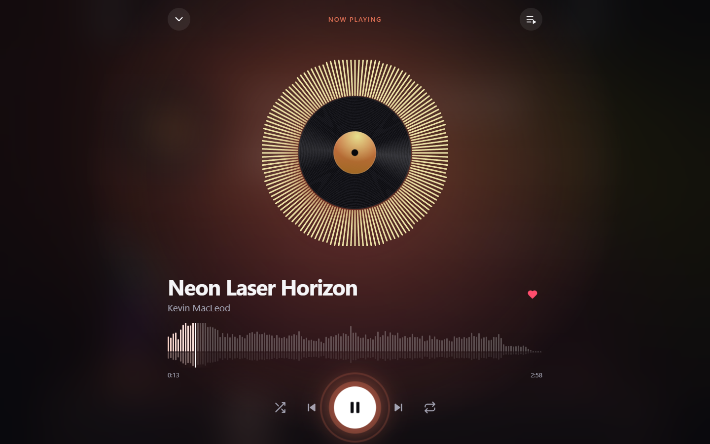
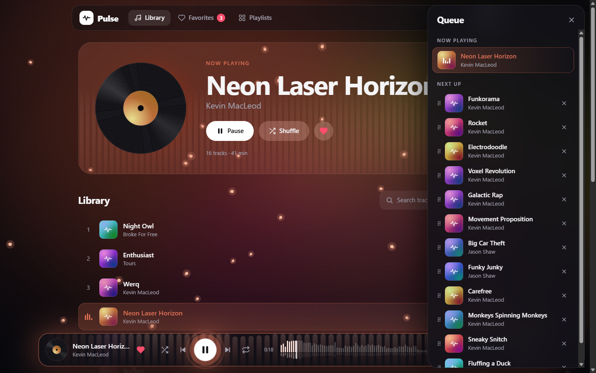
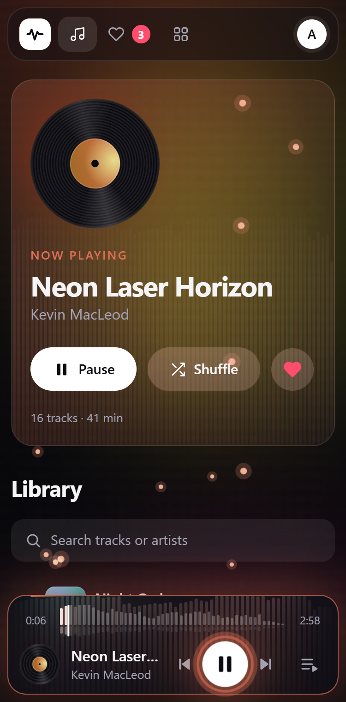

# Pulse — music player

A music player with a real waveform, visuals that react to the sound, a play queue, playlists and accounts. The client is built with React and TypeScript; the audio engine, the waveform and all visual effects are written by hand, without player libraries.

**[Live demo](https://bob-kikosh.github.io/pulse-player/)**



| Full-screen player | Queue | Mobile |
| --- | --- | --- |
|  |  |  |

## Features

**Player**

- Play, pause, next, previous, shuffle and three repeat modes.
- A real waveform of every track, used as a seek bar: click or drag it with a mouse or a finger.
- A play queue: see what comes next, drag tracks into a new order, remove them, or send any track to play next.
- Keyboard shortcuts for everything, hardware media keys and lock-screen controls (Media Session API).
- Volume, shuffle and repeat settings survive a page reload.

**Visuals that follow the music**

- A live frequency spectrum, drawn from the Web Audio analyser: as bars in the library header and as a ring around the record in the full-screen player.
- Particles that jump on every bass hit, burst apart when the track changes and gather into a heart when you like a track.
- A background whose color follows the current track and swells with the bass.
- A player bar that glows and beats in time with the music, and a vinyl record that spins while a track plays.
- Everything respects the "reduce motion" system setting.

**Library and accounts**

- Search by title or artist.
- Sign up and sign in; the session is restored on reload.
- Favorites and your own playlists: create, rename, delete, add and remove tracks.
- Listening works without an account; signing in is only needed to save things.

**Responsive layout** from 320px phones to wide desktops.

## Tech stack

- **Client:** React 19, TypeScript, Vite, Zustand, React Router, CSS Modules
- **Audio and graphics:** HTMLAudioElement, Web Audio API (AnalyserNode), Canvas 2D
- **Server:** Node.js, Express, JWT, bcrypt
- **Tooling:** ESLint, GitHub Actions (lint, build and deploy to GitHub Pages)

## Two ways to run it

The client talks to its backend through one small interface (`client/src/api/types.ts`) that has two implementations.

| | Demo mode | Server mode |
| --- | --- | --- |
| Where accounts live | In the browser (`localStorage`) | On the Express server (JSON file) |
| What it needs | Nothing: a static site | The server from the `server` folder |
| Used for | The live demo on GitHub Pages | Local development, a real deployment |

The mode is chosen at build time: with `VITE_API_URL` set the client uses the server, without it everything runs in the browser.

### Demo mode

```bash
cd client
```

```bash
npm install
```

```bash
npm run dev
```

The app opens at `http://localhost:5173`.

### Server mode

Start the server:

```bash
cd server
```

```bash
npm install
```

```bash
npm start
```

It listens on `http://localhost:8000`. Then, in another terminal, start the client and point it at the server:

```bash
cd client
```

```bash
cp .env.example .env.local
```

```bash
npm run dev
```

Server settings are environment variables: `PORT` (default `8000`), `CLIENT_ORIGIN` (the client's address for CORS, default `http://localhost:5173`) and `JWT_SECRET` (set your own outside development).

## API

All routes start with `/api`. Routes marked 🔒 need an `Authorization: Bearer <token>` header.

| Method | Route | What it does |
| --- | --- | --- |
| GET | `/tracks` | List of tracks |
| POST | `/register` | Create an account, returns a token |
| POST | `/login` | Sign in, returns a token |
| GET | `/profile` 🔒 | The signed-in user |
| GET | `/favorites` 🔒 | Ids of favorite tracks |
| PUT | `/favorites/:trackId` 🔒 | Add a track to favorites |
| DELETE | `/favorites/:trackId` 🔒 | Remove a track from favorites |
| GET | `/playlists` 🔒 | The user's playlists |
| POST | `/playlists` 🔒 | Create a playlist |
| PATCH | `/playlists/:id` 🔒 | Rename a playlist or replace its tracks |
| DELETE | `/playlists/:id` 🔒 | Delete a playlist |

## Project structure

```text
├── client/                  # React application
│   ├── public/audio/        # Music files
│   └── src/
│       ├── api/             # Backend interface and its two implementations
│       ├── audio/engine.ts  # The audio element and the Web Audio analyser
│       ├── components/      # PlayerBar, Waveform, Spectrum, Particles, NowPlaying, QueuePanel…
│       ├── data/tracks.json # Track list with durations and waveform peaks (generated)
│       ├── hooks/           # Keyboard shortcuts, media session, audio-reactive styles
│       ├── pages/           # Library, Favorites, Playlists, Profile
│       ├── store/           # Zustand stores: player, tracks, auth, favorites, playlists, UI
│       └── utils/
├── server/                  # Express API
│   └── src/
│       ├── routes/          # auth, favorites, playlists
│       ├── middleware/      # JWT check
│       └── db.js            # JSON-file storage
└── scripts/
    └── build-tracks.mjs     # Decodes the MP3 files and builds tracks.json
```

## How it works

- **No re-renders during playback.** The waveform, the spectrum, the particles and the glow of the player bar are drawn in their own animation-frame loops that read the audio element and the analyser directly. React state changes only when something actually changes for the interface: a new track, play or pause.
- **Waveforms are precomputed.** `scripts/build-tracks.mjs` decodes every MP3 once and saves 240 peak values and the duration into `tracks.json`. The browser never downloads a whole file just to draw its waveform.
- **Sound-reactive styles without JavaScript animation code.** A small hook writes the current bass level into a CSS variable every frame, and plain CSS turns it into glow, scale and color.
- **Optimistic updates.** Likes and playlist changes appear immediately and roll back if the request fails.
- **One queue for everything.** "Next" and "previous" walk through the list the current track was started from: the library, favorites or a playlist.

## Keyboard shortcuts

| Key | Action |
| --- | --- |
| Space | Play or pause |
| ← → | Seek 5 seconds |
| ↑ ↓ | Volume |
| N / P | Next or previous track |
| L | Like the current track |
| S / R / M | Shuffle, repeat, mute |
| F | Full-screen player |
| Q | Queue |

## Music

All tracks are published by their authors under Creative Commons Attribution licenses.

| Tracks | Artist | License | Source |
| --- | --- | --- | --- |
| Carefree, Electrodoodle, Fluffing a Duck, Funkorama, Galactic Rap, Monkeys Spinning Monkeys, Movement Proposition, Neon Laser Horizon, Rocket, Sneaky Snitch, Voxel Revolution, Werq | Kevin MacLeod | [CC BY 4.0](https://creativecommons.org/licenses/by/4.0/) | [incompetech.com](https://incompetech.com/) |
| Big Car Theft, Funky Junky | Jason Shaw | [CC BY 4.0](https://creativecommons.org/licenses/by/4.0/) | [audionautix.com](https://audionautix.com/) |
| Night Owl | Broke For Free | [CC BY 3.0](https://creativecommons.org/licenses/by/3.0/) | [Free Music Archive](https://freemusicarchive.org/music/Broke_For_Free/) |
| Enthusiast | Tours | [CC BY 3.0](https://creativecommons.org/licenses/by/3.0/) | [Free Music Archive](https://freemusicarchive.org/music/Tours/) |

The audio files were not modified.

## About

A study project. It started as a course assignment for an audio player with a small Express backend; the client, the visual effects and the current server in this repository are my own work.
